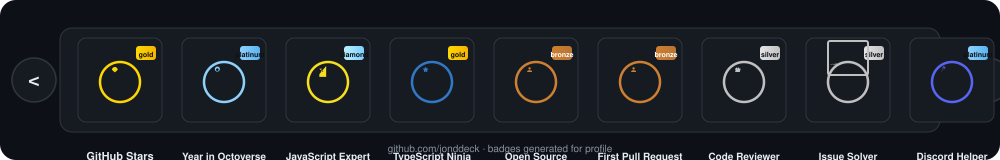

## Hi there 👋

# About me
- 🔭 I’m currently working on ...
- 🌱 I’m currently learning ...
- 👯 I’m looking to collaborate on ...
- 🤔 I’m looking for help with ...
- 💬 Ask me about ...
- 📫 reach me: ...
- 😄 Pronouns: ...
- ⚡ Fun fact: ...

<h2 align="center">📊 Coding Statistics</h2>

<h2 align="center">🏅 Attained Badges</h2>

 
<em>Click the image to open the interactive badge belt with &lt; &gt; navigation.</em>

<!--
**jonddeck/jonddeck** is a ✨ _special_ ✨ repository because its `README.md` (this file) appears on your GitHub profile.

Here are some ideas to get you started:

-->
