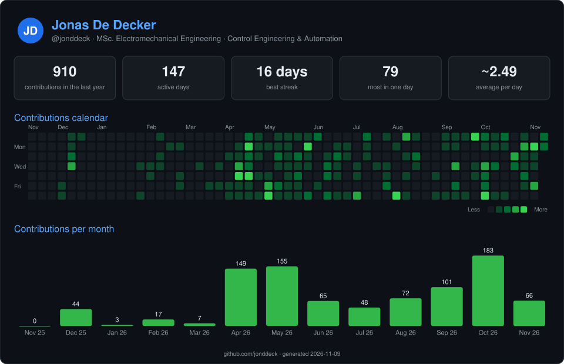

<h3 align="left"> Hi there! </h3> 

    

<h2 align="center"> About me</h2>

- 🔭 I’m currently working on: my portfolio
- 🌱 I’m currently learning: C++
- 👯 I’m looking to collaborate on: IoT
- 🤔 I’m looking for help with: Energy Conversion
- 💬 Ask me about: open-source programming
- 📫 reach me: via mail
- 😄 Pronouns: He/Him
- ⚡ Fun fact: The first robot was a Flying Pigeon,  a steam-powered wooden bird built by Greek philosopher Archytas of Tarentum around 400 BC. It's recognized by Guinness World Records as the first robot ever. 

<h2 align="center"> Projects (private)</h2>
- Automated Git Source Control 
- Electric Drawing Tool
- CNN's for image classification
- Computer Vision with OpenCL
- CRM tool for mobile concept idea prototype generations
- Centralized launch platform for personal applications

<h2 align="center">📊 Coding Statistics</h2>

<h2 align="center">🏅 Attained Badges</h2>

 

<h3 align="left">Languages and Tools:</h3>

 

<!--  -->
<!--  -->
<!--  -->
 
 
 
 
 
 
 
 
<!-- 
 
 
<a href="https://www.w3.org/html/" target="_blank"> -->
 </a> 
 
 
 
 
 
  
 
 
 

 
 

<!-- Comments -->

<!-- <em>Open the image directly for interactive &lt; &gt; badge belt navigation.</em>

 -->

<!--
**jonddeck/jonddeck** is a ✨ _special_ ✨ repository because its `README.md` (this file) appears on your GitHub profile.

Here are some ideas to get you started:

-->
